# Modul 5 — Mail Server dan Firewall

## 1. Tujuan Praktikum

1.1 Praktikan mampu memahami konsep dan cara kerja Mail Server
1.2 Praktikan dapat melakukan instalasi dan konfigurasi Mail Server pada Rocky Linux
1.3 Praktikan memahami konsep dan cara kerja Firewall
1.4 Praktikan dapat melakukan konfigurasi Firewall pada Rocky Linux

## 2. Alat dan Bahan

2.1 Laptop
2.2 ISO Rocky Linux 8.6
2.3 VMWare Workstation 16.x
2.4 Thunderbird
2.5 Telnet

## 3. Landasan Teori

### 3.1 Mail Server

#### 3.1.1 Definisi

Mail Server merupakan sebuah server yang memungkinkan pengguna (user) untuk dapat mengirim dan menerima e-mail dengan cara mendistribusikan file maupun informasi sebagai balasan atau respon atas permintaan yang dikirim oleh pengguna melalui e-mail. Adapun fungsi dari mail server yaitu sebagai pengatur, penerima dan penyalur respons atas e-mail yang masuk, dan merespons setiap e-mail yang masuk dan keluar.

#### 3.1.2 Protokol Mail Server

Pada mail server terdapat tiga protokol utama yang digunakan untuk mengelola mail server. Protokol tersebut dibedakan menjadi dua berdasarkan cara kerjanya, yaitu incoming mail server dan outgoing mail server. Incoming mail server yaitu server yang digunakan untuk penerimaan e-mail dan protokol yang menanganinya yaitu POP3 dan IMAP. Sedangkan outgoing mail server merupakan server yang digunakan untuk pengiriman e-mail dan protokol yang menanganinya yaitu SMTP.

Berikut penjelasan tiga protokol utama pada mail server:

**a. Post Office Protocol version 3 (POP3)**

Post Office Protocol version 3 merupakan protokol e-mail yang digunakan untuk menerima e-mail dari server lokal ke e-mail client dimana protokol POP3 memungkinkan client untuk mengunduh pesan e-mail pada komputer lokal pengguna dan membaca e-mail tersebut bahkan dalam keadaan offline. Port yang digunakan pada POP3 yaitu 110 dengan secure port yaitu 995. Fungsi dari protokol ini adalah sebagai alat komunikasi dengan e-mail server serta mengunduh seluruh e-mail ke e-mail lokal tanpa harus membuat salinan dari server.

**b. Internet Message Access Protocol (IMAP)**

Internet Message Access Protocol merupakan protokol e-mail yang digunakan untuk mengakses e-mail pada web server dari local client. IMAP dan POP3 adalah protokol yang umum digunakan agar pengguna dapat mengambil dan membaca e-mail secara remote tanpa perlu login ke dalam sistem shell mail server. IMAP dan POP3 didukung oleh semua e-mail client dan web server. Port yang digunakan pada IMAP yaitu 143 dengan secure port 993. IMAP berfungsi sebagai perubahan yang memang dibuat untuk local mail dan dikirimkan ke server.

**c. Simple Mail Transfer Protocol (SMTP)**

Simple Mail Transfer Protocol digunakan untuk berkomunikasi dengan server yang digunakan untuk mengirimkan e-mail dari lokal e-mail ke server, sebelum akhirnya dikirimkan ke server e-mail penerima. SMTP juga digunakan sebagai standar untuk menampung dan mendistribusikan e-mail. Port yang digunakan pada SMTP yaitu 25 dengan secure port 465.

#### 3.1.3 Komponen pada Mail Server

Mail Server memiliki beberapa komponen dasar yang penting untuk mendukung pengoperasian. Beberapa komponen yang biasanya dimiliki oleh mail server ada empat, yaitu sebagai berikut:

**Tabel 3.1 Komponen pada Mail Server**

| Komponen | Deskripsi |
|---|---|
| Mail User Agent (MUA) | MUA merupakan komponen pada mail server yang berinteraksi dengan end-user secara langsung. MUA memiliki beberapa program yang memang terkait kedalam proses membaca serta membuat e-mail. MUA ini memiliki tugas untuk membaca e-mail, menerima dan memberikan perintah untuk membuat serta mengirimkan pesan. |
| Mail Submission Agent (MSA) | MSA merupakan perangkat lunak komputer yang menerima e-mail dari Mail User Agent (MUA) dan bekerjasama dengan Mail Transfer Agent (MTA) untuk mengirimkan sebuah e-mail. |
| Mail Transfer Agent (MTA) | MTA menerima mail yang ditujukan secara lokal dari domain lain, dan MSA menerima submit email dari pengguna lokal. Komponen yang tercantum dengan protokol pengiriman e-mail yang memiliki tugas untuk dapat mengurus bagian dari pengiriman email tersebut. Contoh dari MTA yaitu Sendmail, Postfix, qmail, Exim dan lain-lain. |
| Mail Delivery Agent (MDA) | MDA sering digunakan untuk mengirimkan pesan e-mail dengan jaringan yang memang dipilih olehnya. Selain itu, MDA juga bisa berfungsi sebagai filter spam e-mail, virus detection dan pengiriman balasan e-mail secara otomatis. Contoh MDA pada sistem Linux antara lain Procmail, POP3, Courier IMAP, dan Dovecot. MDA dapat secara langsung terintegrasi pada MTA, seperti pada Microsoft Exchange. |

#### 3.1.4 Cara Kerja Mail Server

Cara kerja mail server tidak terlepas dari protokol (POP3, IMAP, SMTP) dan komponen (MUA, MTA, MDA). Terdapat juga komponen pendukung seperti DNS untuk pemberian nama dan database untuk penyimpanan domain table. Berikut merupakan skema cara kerja dari mail server.

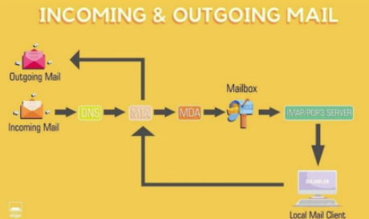

*Gambar 3.1 Cara Kerja Mail Server*

Pada gambar di atas dapat dilihat bahwa mail server menerima e-mail, dan e-mail yang masuk akan melewati DNS yang selanjutnya diteruskan ke MTA. Kemudian dari MTA melanjutkan ke MDA dan diteruskan ke personal mailbox user agar dapat diakses oleh MUA. Kemudian dari MUA akan melakukan pengiriman e-mail ke MTA tanpa melalui MDA.

Modul mail server kali ini, kita akan melakukan konfigurasi mail server pada Rocky Linux dengan menggunakan beberapa aplikasi. Diantaranya adalah Postfix berperan sebagai MTA (Transfer), Dovecot sebagai MDA (Delivery) dan Thunderbird sebagai MUA (User Interface).

#### 3.1.5 Proses Pengiriman E-mail

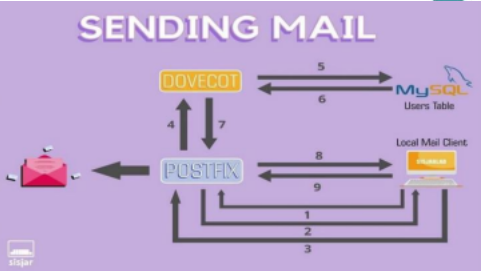

*Gambar 3.2 Proses Pengiriman E-mail*

Berikut penjelasan proses pengiriman e-mail:

1. Mail client akan membangun koneksi dengan Postfix untuk pengiriman e-mail.
2. Postfix menerima perintah mail client kemudian meminta autentikasi berupa username dan password untuk mengirimkan e-mail dari mail client.
3. Mail client mengirimkan username dan password yang diminta ke Postfix.
4. Postfix akan meneruskan username dan password ke Dovecot untuk dilakukan pemeriksaan.
5. Dovecot kemudian mengakses database untuk menyamakan username dan password yang diterima.
6. Jika username dan password terdaftar dalam database maka akan dikirim ke Dovecot.
7. Dovecot kemudian melakukan konfirmasi ke Postfix bahwa username dan password terdaftar dan cocok.
8. Postfix melakukan konfirmasi ke mail client bahwa autentikasi berhasil.
9. Mail client mengirimkan e-mail ke Postfix yang akan diteruskan ke domain yang dituju.

#### 3.1.6 Proses Pengecekan E-mail

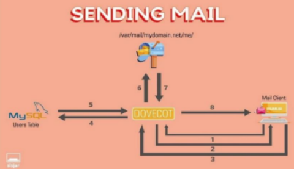

*Gambar 3.3 Proses Pengecekan E-mail*

Berikut penjelasan dari gambar proses pengecekan e-mail di atas:

1. Mail client akan membangun koneksi melalui IMAP ke Dovecot.
2. Dovecot memberikan konfirmasi dan meminta autentifikasi berupa username dan password.
3. Mail client mengirimkan username dan password yang diminta ke Dovecot.
4. Dovecot meneruskan username dan password ke database untuk dilakukan pemeriksaan dan pencocokan.
5. Jika username dan password terdaftar dalam database maka akan dikirim ke Dovecot.
6. Dovecot kemudian mengakses mailbox untuk mengambil e-mail.
7. Mailbox memberikan e-mail ke Dovecot.
8. Dovecot meneruskan e-mail yang didapat ke mail client.

#### 3.1.7 Proses Penerimaan E-mail

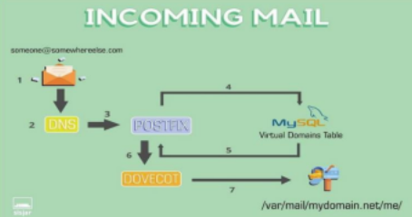

*Gambar 3.4 Proses Penerimaan E-mail*

Berikut penjelasan dari gambar proses penerimaan e-mail di atas:

1. someone@somewhereelse.com mengirimkan e-mail ke alamat e-mail penerima.
2. DNS melakukan pengecekan untuk meneruskan e-mail ke alamat penerima.
3. E-mail masuk terlebih dahulu ke Postfix.
4. Postfix memeriksa ke database untuk pengecekan domain dan menentukan apakah e-mail tersebut dapat meneruskan ke alamat e-mail penerima.
5. E-mail yang sudah dikonfirmasi dapat diteruskan melalui Postfix.
6. Postfix selanjutnya meneruskan e-mail ke Dovecot.
7. Dovecot kemudian mengirim dan menyimpan e-mail ke mailbox.

### 3.2 Firewall

#### 3.2.1 Definisi Firewall

Firewall merupakan sistem keamanan jaringan komputer yang digunakan untuk melindungi sistem. Firewall berupa software dan hardware, yang berfungsi sebagai monitoring paket data yang melintas dari jaringan atau komputer. Firewall yang berbentuk software, pada umumnya akan diinstalasi pada komputer. Firewall akan menganalisis paket data dan mempelajari sumber paket data, komputer yang dituju oleh paket data, protokol yang digunakan, dan juga isi dari paket data yang melintas di firewall tersebut. Dengan menggunakan firewall, kita dapat memblokir paket data dari sumber-sumber atau alamat-alamat tertentu, memblokir pertukaran data antar komputer, mencegah penggunaan protokol tertentu, dan menolak paket yang mencurigakan.

#### 3.2.2 Fungsi Firewall

Berikut merupakan fungsi dari firewall:

1. **Menjaga keamanan jaringan.** Seluruh lalu lintas yang masuk ataupun keluar harus melewati Firewall sebagai penjaga keamanan yang akan melakukan pemeriksaan.
2. **Mengurangi bocornya informasi.** Untuk mencegah informasi yang bocor tanpa sepengetahuan kita maka Firewall banyak dipasang untuk File Transfer Protocol (FTP) sehingga lalu lintas data dikendalikan oleh Firewall.
3. **Melakukan inspeksi paket data yang masuk dan keluar.** Firewall akan melakukan pengecekan dari paket data dengan melakukan verifikasi seperti:
   - IP address sumber
   - Port sumber
   - IP address tujuan
   - Port tujuan
   - Protokol IP
   - Informasi header yang ada dalam paket
4. **Mencatat aktivitas pengguna.** Tiap mengakses sebuah data maka user akan mengakses jaringan yang akan melalui Firewall dimana akan dicatat sebagai dokumentasi untuk pengembangan sistem keamanan jaringan.
5. **Memodifikasi paket data yang datang.** Proses ini disebut Network Address Translation (NAT) dimana NAT akan menyembunyikan IP address private yang dimiliki sehingga dapat membuat user mengakses internet tanpa IP address public.

#### 3.2.3 Cara Kerja Firewall

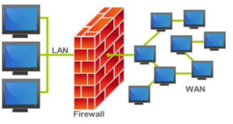

*Gambar 3.5 Cara Kerja Firewall*

Firewall bekerja seperti penjaga keamanan yang akan mengidentifikasi pengunjung yang datang dan menyaring penyusup yang berusaha masuk ke komputer. Firewall sebagai garda pertahanan terdepan untuk menahan segala usaha penyusupan yang akan masuk ke komputer.

Awalnya Firewall hanya bekerja untuk menyaring lalu lintas data dengan menggunakan IP address, nomor port serta protokol yang digunakan. Namun semakin berkembangnya Firewall, kini Firewall dapat melakukan penyaringan data yang masuk dengan mengidentifikasi terlebih dahulu isi dari paket tersebut.

Beberapa metode yang digunakan untuk mengatur lalu lintas pada Firewall adalah:

**1. Packet Filtering**

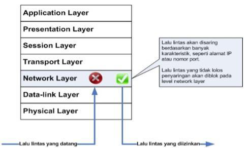

*Gambar 3.6 Packet Filtering*

Packet Filtering disebut juga sebagai Firewall statis. Saat terjadi komunikasi antar satu komputer tujuan ke komputer penerima, maka paket tersebut akan disaring dan dicocokkan dengan aturan yang telah dibuat dalam Firewall. Jika data tidak cocok maka data akan ditolak, namun sebaliknya jika data tersebut cocok maka data akan dapat diterima dan diteruskan ke penerima. Dalam metode ini Firewall akan mengecek IP address sumber dan IP address tujuan serta protokol sumber dan protokol tujuan yang akan dicocokkan dengan Access Control List Firewall dimana yang menjadi penyaringnya adalah berupa router.

**2. Firewall Stateful**

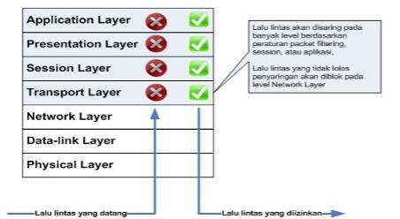

*Gambar 3.7 Firewall Stateful*

Firewall Stateful disebut juga sebagai Firewall dinamis. Pada metode ini status aktif koneksi dimonitor dan informasi yang didapatkan digunakan untuk menentukan apakah sebuah paket dapat melewati Firewall.

Pada Firewall statis hanya dilihat header dari paket saja, namun pada Firewall dinamis paket akan dilihat hingga ke lapisan dalamnya seperti isi dari pesan paket tersebut, sehingga keamanan lebih ketat dibanding filtering statis.

**3. Circuit Level Gateway**

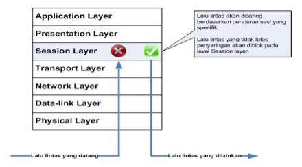

*Gambar 3.8 Circuit Level Gateway*

Firewall ini berfungsi untuk menyembunyikan informasi mengenai jaringan yang terproteksi namun tidak melakukan penyaringan pada paket-paket yang ada dalam jaringan. Pada Firewall ini koneksi antar user dan jaringan disembunyikan, sehingga user langsung membuat koneksi dengan Firewall dan Firewall akan membentuk koneksi dengan sumber daya jaringan yang diakses oleh user dengan mengubah IP address dari paket yang ditransmisikan oleh dua belah pihak. Hal ini menyebabkan terbentuknya sebuah circuit virtual antar user dan sumber daya jaringan yang diakses. Firewall ini lebih aman dibandingkan dengan packet filtering, karena pengguna eksternal tidak dapat melihat IP address dari user dalam paket yang diterima namun hanya melihat IP address dari Firewall.

**4. Application Level Gateway**

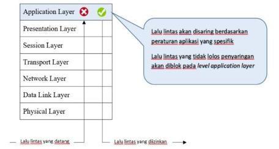

*Gambar 3.9 Application Level Gateway*

Application Level Gateway disebut juga sebagai proxy Firewall. Metode Firewall ini umumnya menggunakan proxy server. Proxy yang ada pada komputer akan berfungsi sebagai Firewall untuk memberi izin hak akses ke jaringan tujuan. Firewall ini akan melakukan autentikasi terlebih dahulu terhadap user tersebut untuk mengakses jaringan. Selain itu, Firewall ini juga mengimplementasikan mekanisme auditing dan pencatatan sebagai kebijakan dari keamanan yang diterapkan.

Pada Firewall ini memerlukan beberapa konfigurasi yang lebih spesifik dimana komputer yang digunakan diharuskan memiliki spesifikasi yang tinggi, sehingga memiliki kinerja yang lebih lambat dibanding dengan packet Firewall.

### 3.3 Firewalld

#### 3.3.1 Definisi

Firewalld adalah perangkat lunak untuk manajemen firewall pada sistem operasi berbasis Linux, menjadi front-end dari iptables packet filtering yang sudah tersedia pada kernel Linux. Konsep firewalld yaitu menggunakan zones dan services, dibandingkan dengan iptables yang menggunakan chain dan rules. Berdasarkan pada zones dan services, dapat mengontrol koneksi jaringan mana yang diizinkan dan tidak diizinkan masuk atau keluar dari sistem.

#### 3.3.2 Firewalld Zones

Firewalld zones adalah kumpulan aturan yang telah ditetapkan, koneksi jaringan mana yang seharusnya diizinkan berdasarkan tingkat kepercayaan pada jaringan yang terhubung ke sistem. User dapat menetapkan nama interface jaringan dan sumber jaringan ke dalam zones.

Di bawah ini zones yang tersedia pada firewalld yang disusun berdasarkan tingkat kepercayaan, dari tidak terpercaya ke terpercaya.

**Tabel 3.2 Firewalld Zones**

| Zone | Definisi |
|---|---|
| Drop | Semua koneksi jaringan yang masuk didrop tanpa adanya notifikasi atau pesan error. Hanya koneksi jaringan yang keluar dari sistem yang diizinkan. |
| Block | Semua koneksi jaringan yang masuk di-reject dengan pesan icmp-host-prohibited untuk IPv4 dan icmp6-adm-prohibited untuk IPv6. Hanya koneksi jaringan yang keluar yang diizinkan. |
| Public | Jaringan yang tidak bisa dipercaya karena dapat memilih koneksi jaringan apa yang diizinkan. |
| External | Jika menggunakan Linux sebagai gateway atau router. Dikonfigurasi sebagai NAT masquerading. Hanya trafik yang dipilih yang diizinkan. |
| DMZ | Demilitarized zone, jika kita ingin memberikan akses terhadap services ke jaringan publik. Hanya koneksi jaringan yang dipilih saja yang diizinkan. |
| Work | Zona yang digunakan jaringan internal kantor. Semua sistem dalam jaringan kantor dapat dipercaya, hanya koneksi jaringan yang dipilih yang diizinkan. |
| Home | Zona yang diperuntukkan jaringan internal rumah. Semua sistem dalam jaringan kantor dapat dipercaya, hanya koneksi jaringan yang dipilih yang diizinkan. |
| Trusted | Zona yang paling terbuka, semua sistem pada jaringan dipercaya, dan semua koneksi jaringan diizinkan. |

#### 3.3.3 Command Dasar

1. Untuk melihat default service yang tersedia gunakan command di bawah:

   ```bash
   [root@sisjarlab rocky]# firewall-cmd --get-services
   ```

   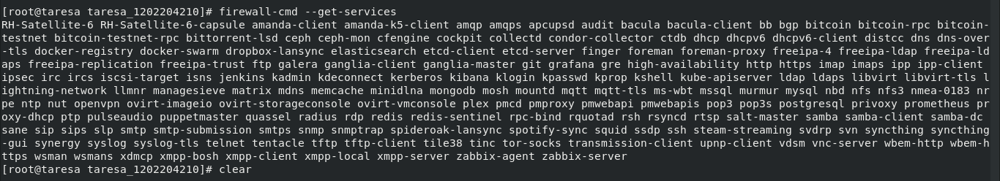

2. Untuk melihat keterangan services yang ada pada directory firewalld gunakan command di bawah:

   ```bash
   [root@sisjarlab rocky]# ls /usr/lib/firewalld/services
   ```

   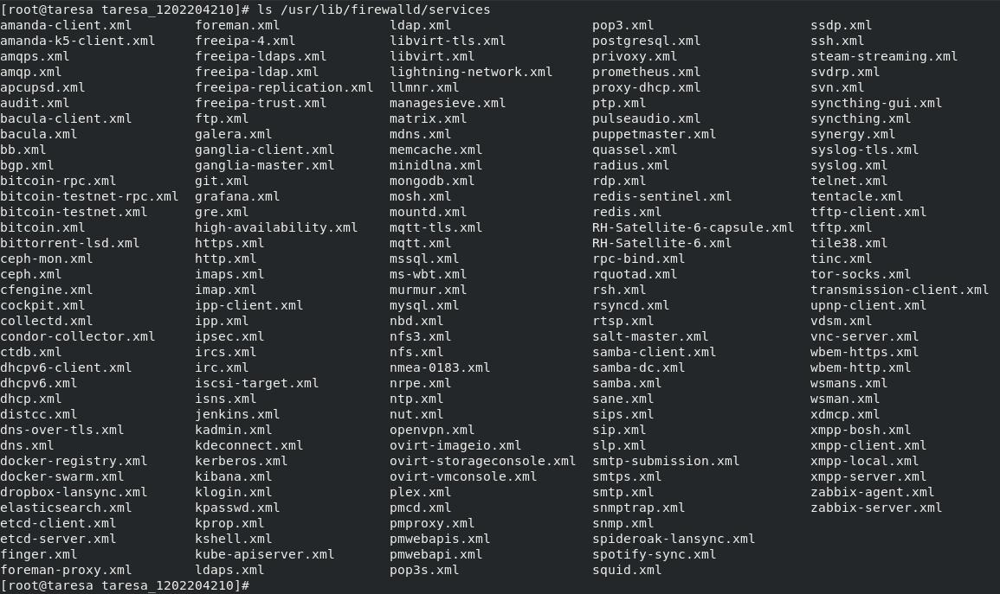

3. Kemudian untuk melihat detail yang ada pada file .xml tersebut gunakan command di bawah:

   ```bash
   [root@sisjarlab rocky]# cat /usr/lib/firewalld/services/dns.xml
   ```

   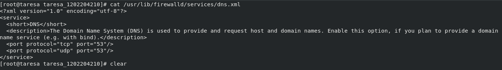

4. Untuk melihat semua konfigurasi pada setiap zone yang aktif gunakan command di bawah:

   ```bash
   [root@sisjarlab rocky]# firewall-cmd --list-all
   ```

   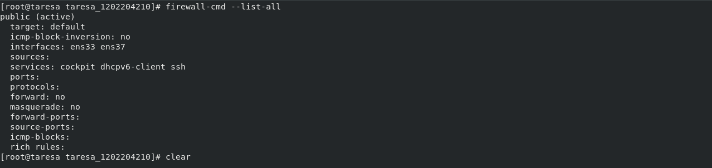

5. Untuk melihat service yang diizinkan pada zona tertentu gunakan command di bawah:

   ```bash
   [root@sisjarlab rocky]# firewall-cmd --list-service --zone=public
   ```

   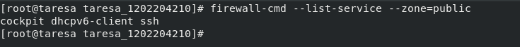

6. Untuk melihat semua konfigurasi pada semua zone yang ada gunakan command di bawah:

   ```bash
   [root@sisjarlab rocky]# firewall-cmd --list-all
   ```

   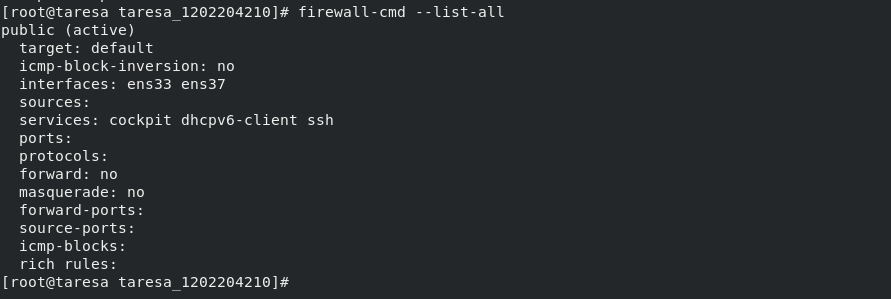

7. Untuk melihat default zone gunakan command di bawah:

   ```bash
   [root@sisjarlab rocky]# firewall-cmd --get-default-zone
   ```

   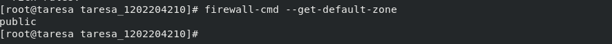

8. Untuk menambahkan service yang diizinkan gunakan command di bawah:

   ```bash
   [root@sisjarlab rocky]# firewall-cmd --zone=public --add-service=http --permanent
   ```

   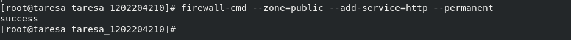

9. Untuk menghapus service yang diizinkan gunakan command di bawah:

   ```bash
   [root@sisjarlab rocky]# firewall-cmd --zone=public --remove-service=http --permanent
   ```

   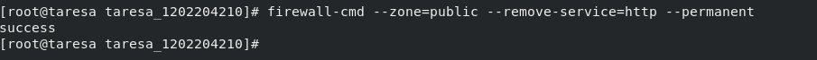

10. Untuk menambahkan port yang diizinkan gunakan command di bawah:

    ```bash
    [root@sisjarlab rocky]# firewall-cmd --zone=public --add-port=80/tcp --permanent
    ```

    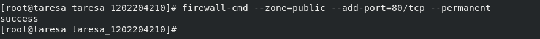

11. Untuk menghapus port yang diizinkan gunakan command di bawah:

    ```bash
    [root@sisjarlab rocky]# firewall-cmd --zone=public --remove-port=80/tcp --permanent
    ```

    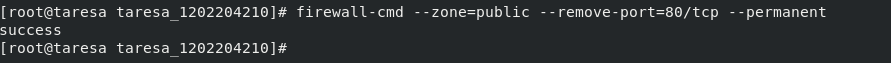

## 4. Lab Praktik

> **BOLEH MENGGUNAKAN PUTTY ATAU TERMINAL PADA ROCKY LINUX**
>
> **JANGAN LUPA UNTUK MEMATIKAN FIREWALL PADA WINDOWS**

### 4.1 Mengaktifkan Koneksi Internet VM Rocky Linux Server

1. Matikan Network Adapter 2 pada VMWare pada pojok kanan bawah.

   

   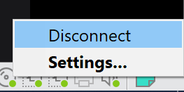

2. Lakukan reboot Rocky Linux.

   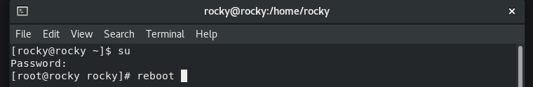

### 4.2 Instalasi Mail Server Package

1. Instalasi Postfix dengan command:

   ```bash
   [root@rocky rocky]# dnf install -y postfix dovecot thunderbird telnet
   ```

   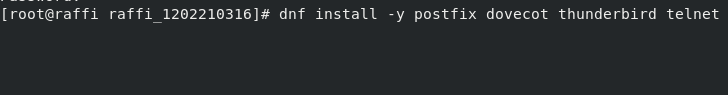

2. Setelah kamu melakukan instalasi semua package, nyalakan kembali Network Adapter 2. Kemudian reboot Rocky Linux anda.

   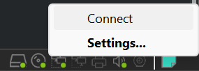

3. Lakukan disable dan enable pada network adapter VMNet1 pada main OS.

   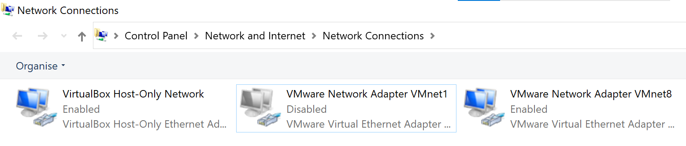

   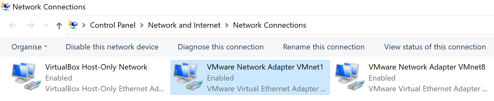

4. Lakukan `ping 10.10.80.1` pada CMD main OS.

   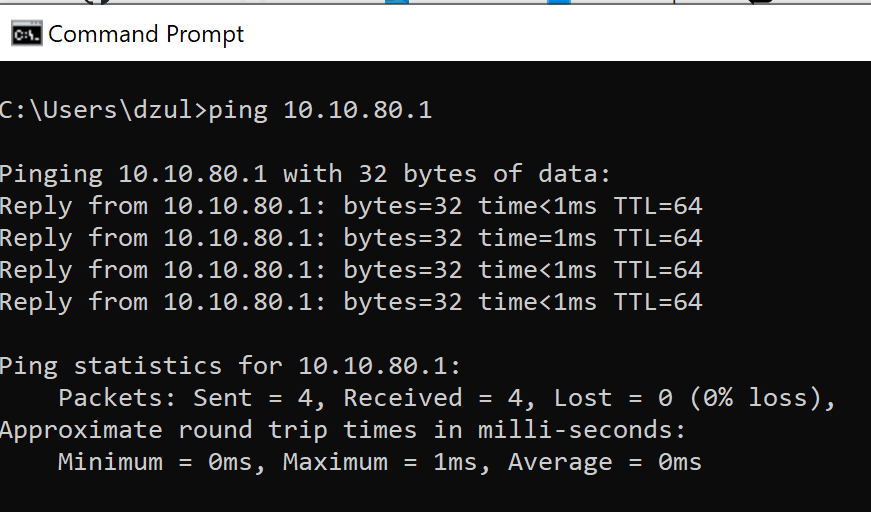

### 4.3 Konfigurasi Postfix

> **Keterangan:** Ganti setiap kata "rocky" menjadi nama pendek seperti nama domain pada modul sebelumnya. Contoh: `mail.raffi.sisjarlab.io`

1. Ganti hostname server dengan memasukkan command:

   ```bash
   [root@rocky rocky]# nano /etc/hosts
   ```

   Tambahkan baris berikut (sesuai gambar):

   ```text
   10.10.80.1 mail.rocky.sisjarlab.io sisjarlab.io
   ```

   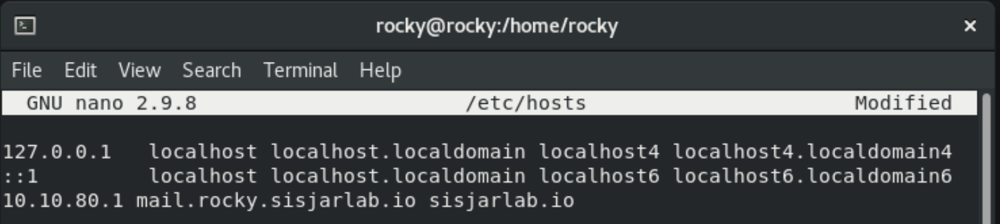

2. Pindah direktori dengan mengetikkan command:

   ```bash
   [root@rocky rocky]# cd /etc/postfix
   ```

3. Lakukan backup file main.cf dengan mengetikkan command:

   ```bash
   [root@rocky postfix]# cp main.cf main.cf.bckp
   ```

4. Kemudian edit file main.cf pada postfix menggunakan command nano atau vi dengan command:

   ```bash
   [root@rocky postfix]# nano main.cf
   ```

   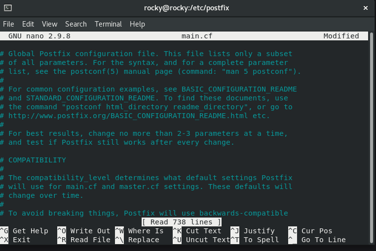

5. Kemudian temukan baris atau line dan edit seperti di bawah.

   > Note: Untuk mencari line dengan mudah tekan `CTRL + Shift + -` (minus)

   - **Line 94** — hilangkan tanda pagar, isikan url seperti berikut, `rocky` sesuaikan dengan DNS sebelumnya.

     ```text
     myhostname = mail.rocky.sisjarlab.io
     ```

   - **Line 102** — hilangkan tanda pagar dan set domain name.

     ```text
     mydomain = rocky.sisjarlab.io
     ```

     `#Sesuaikan hostname dan domain dengan DNS masing-masing#`

   - **Line 118** — hilangkan tanda pagar.

     ```text
     myorigin = $mydomain
     ```

   - **Line 132** — hilangkan tanda pagar.

     ```text
     inet_interfaces = all
     ```

   - **Line 135** — tambahkan tanda pagar.

     ```text
     #inet_interfaces = localhost
     ```

   - Line 132 dan 135 menjadi:

     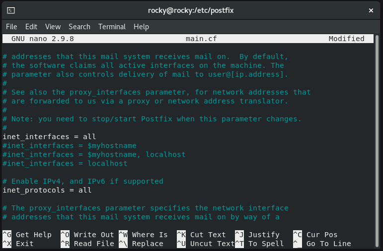

   - **Line 138** — ganti menjadi `all` (lewati jika sudah terisi "all").

     ```text
     inet_protocols = all
     ```

   - **Line 183** — tambahkan tanda pagar.

     ```text
     #mydestination = $myhostname, localhost.$mydomain, localhost
     ```

   - **Line 184** — hilangkan tanda pagar.

     ```text
     mydestination = $myhostname, localhost.$mydomain, localhost, $mydomain
     ```

     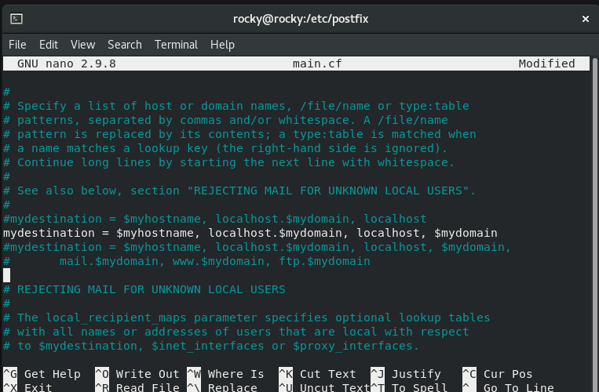

   - **Line 283** — hilangkan tanda pagar dan tambahkan network IP.

     ```text
     mynetworks = 10.10.80.0/25, 127.0.0.0/8
     ```

   - **Line 438** — hilangkan tanda pagar.

     ```text
     home_mailbox = Maildir/
     ```

   - **Line 591** — hilangkan tanda pagar dan tambahkan command seperti berikut.

     ```text
     smtpd_banner = $myhostname POSTFIX SUCCESS
     ```

   **++ TAMBAHKAN DI PALING AKHIR ++**

   ```text
   # Set Limit email size untuk 10MB
   message_size_limit = 10485760

   # Limit a mailbox for 1GB
   mailbox_size_limit = 1073741824

   #for SMTP-Auth
   smtpd_sasl_type = dovecot
   smtpd_sasl_path = private/auth
   smtpd_sasl_auth_enable = yes
   smtpd_sasl_security_options = noanonymous
   smtpd_sasl_local_domain = $myhostname
   smtpd_recipient_restrictions = permit_mynetworks,permit_auth_destination,permit_sasl_authenticated,reject
   ```

   > Note: untuk `smtpd_recipient_restrictions` ditulis setelah "=" bukan di bawahnya.

   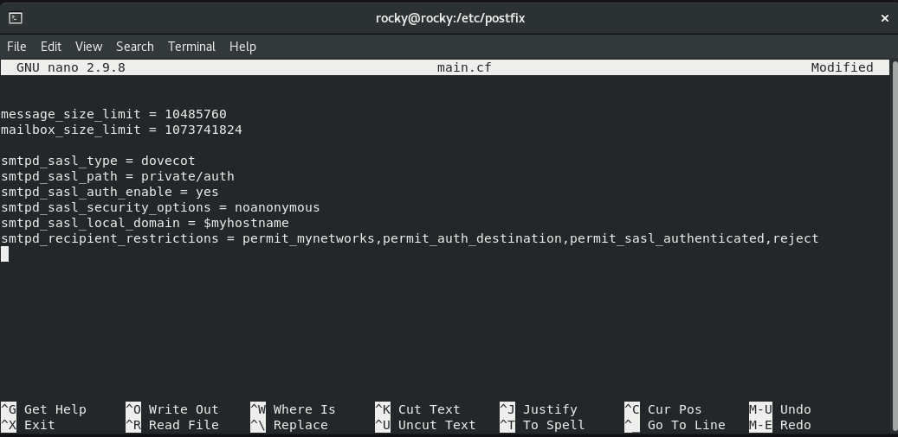

6. Restart dan aktifkan postfix dengan command:

   ```bash
   [root@rocky postfix]# systemctl restart postfix.service
   [root@rocky postfix]# systemctl enable postfix
   ```

7. Kemudian check status postfix dengan command:

   ```bash
   [root@rocky postfix]# systemctl status postfix
   ```

   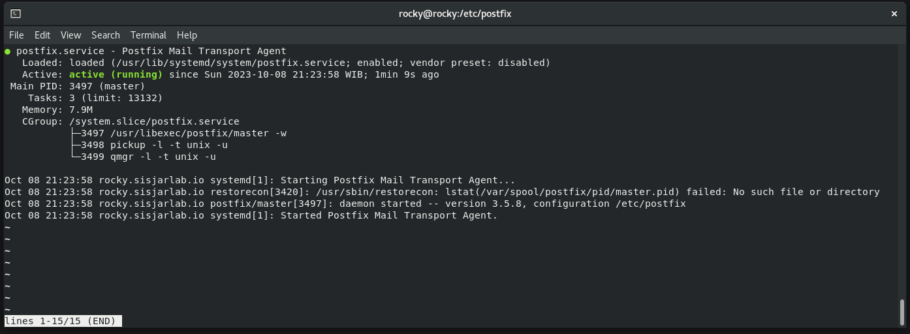

### 4.4 Konfigurasi Dovecot

Lakukan konfigurasi SASL yang berhubungan dengan postfix, berikut beberapa file yang akan dikonfigurasi:

- `/etc/dovecot/dovecot.conf`
- `/etc/dovecot/conf.d/10-auth.conf`
- `/etc/dovecot/conf.d/10-mail.conf`
- `/etc/dovecot/conf.d/10-master.conf`
- `/etc/dovecot/conf.d/10-ssl.conf`

**Langkah-langkah Konfigurasi:**

1. Lakukan backup semua file yang akan dikonfigurasi di atas dengan menambahkan `.bak` pada akhir nama file, contoh:

   ```bash
   [root@rocky sisjarlab]# cp /etc/dovecot/dovecot.conf /etc/dovecot/dovecot.conf.bak
   [root@rocky sisjarlab]# cp /etc/dovecot/conf.d/10-auth.conf /etc/dovecot/conf.d/10-auth.conf.bak
   [root@rocky sisjarlab]# cp /etc/dovecot/conf.d/10-mail.conf /etc/dovecot/conf.d/10-mail.conf.bak
   [root@rocky sisjarlab]# cp /etc/dovecot/conf.d/10-master.conf /etc/dovecot/conf.d/10-master.conf.bak
   [root@rocky sisjarlab]# cp /etc/dovecot/conf.d/10-ssl.conf /etc/dovecot/conf.d/10-ssl.conf.bak
   ```

2. Kemudian edit dengan command nano atau vi pada file `dovecot.conf`:

   ```bash
   [root@rocky sisjarlab]# nano /etc/dovecot/dovecot.conf
   ```

   - **Line 24** — hilangkan tanda pagar dan ubah konfigurasi seperti di bawah.

     ```text
     protocols = imap pop3 lmtp
     ```

   - **Line 30** — hilangkan tanda pagar dan edit seperti berikut (hilangkan selain tanda `*`).

     ```text
     listen = *
     ```

3. Kemudian pada file `10-auth.conf` dengan command:

   ```bash
   [root@rocky sisjarlab]# nano /etc/dovecot/conf.d/10-auth.conf
   ```

   - **Line 10** — hilangkan tanda pagar dan ubah.

     ```text
     disable_plaintext_auth = no
     ```

   - **Line 100** — tambahkan.

     ```text
     auth_mechanisms = plain login
     ```

4. Kemudian pada file `10-mail.conf` dengan command:

   ```bash
   [root@rocky sisjarlab]# nano /etc/dovecot/conf.d/10-mail.conf
   ```

   - **Line 30** — hilangkan tanda pagar dan tambahkan seperti berikut.

     ```text
     mail_location = maildir:~/Maildir
     ```

5. Kemudian pada file `10-master.conf` dengan command:

   ```bash
   [root@rocky sisjarlab]# nano /etc/dovecot/conf.d/10-master.conf
   ```

   - **Line 107–112** — hilangkan tanda pagar dan tambahkan.

     ```text
     unix_listener /var/spool/postfix/private/auth {
     mode = 0666

     user = postfix
     group = postfix

     }
     ```

     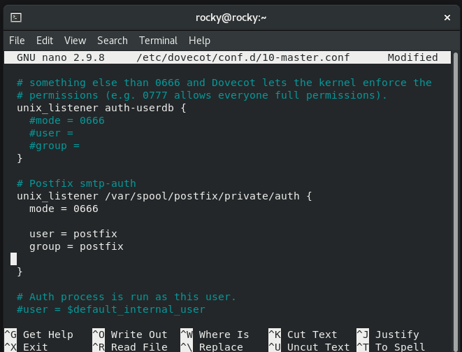

6. Kemudian pada file `10-ssl.conf` dengan command:

   ```bash
   [root@rocky sisjarlab]# nano /etc/dovecot/conf.d/10-ssl.conf
   ```

   - **Line 8** — ubah menjadi `no`.

     ```text
     ssl = no
     ```

7. Restart dan aktifkan dovecot dengan command:

   ```bash
   [root@rocky sisjarlab]# systemctl restart dovecot
   [root@rocky sisjarlab]# systemctl enable dovecot
   [root@rocky sisjarlab]# cd ~
   ```

8. Lakukan verifikasi dengan menggunakan Telnet. Ketikkan `quit` atau tekan `CTRL + C` untuk keluar dengan command:

   ```bash
   [root@rocky ~]# telnet rocky.sisjarlab.io smtp
   [root@rocky ~]# telnet rocky.sisjarlab.io pop3
   [root@rocky ~]# telnet rocky.sisjarlab.io imap
   ```

   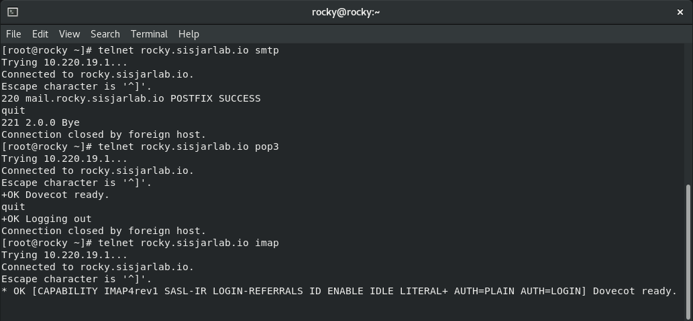

9. Kemudian pindah ke direktori zones dengan command:

   ```bash
   [root@rocky ~]# cd /etc/named/zones
   ```

10. Buka file dengan command `nano /etc/named/zones/db.rocky.sisjarlab.io` dan tambahkan konfigurasi seperti di gambar (record `MX` dan `mail`).

    ```bash
    [root@rocky zones]# nano /etc/named/zones/db.rocky.sisjarlab.io
    ```

    ```text
    $TTL    604800
    @       IN      SOA     ns1.rocky.sisjarlab.io. root.rocky.sisjarlab.io. (
                              3     ; Serial
                         604800     ; Refresh
                          86400     ; Retry
                        2419200     ; Expire
                         604800 )   ; Negative Cache TTL

    @       IN      NS      ns1.rocky.sisjarlab.io.
    @       IN      A       10.10.80.1
    @       IN      MX      1       mail.rocky.sisjarlab.io

    ns1     IN      A       10.10.80.1
    web     IN      CNAME   ns1
    mail    IN      A       10.10.80.1
    ```

    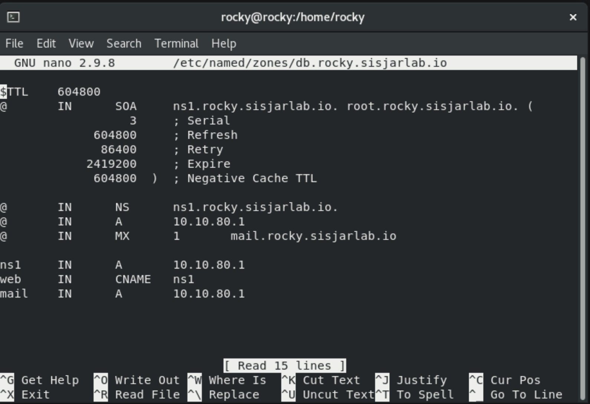

11. Selanjutnya buka file dengan command `nano /etc/named/zones/db.10.10.80` dan tambahkan konfigurasi seperti pada gambar (record `PTR` untuk `mail`).

    ```bash
    [root@rocky zones]# nano /etc/named/zones/db.10.10.80
    ```

    ```text
    $TTL    604800
    @       IN      SOA     ns1.rocky.sisjarlab.io. root.rocky.sisjarlab.io. (
                              3     ; Serial
                         604800     ; Refresh
                          86400     ; Retry
                        2419200     ; Expire
                         604800 )   ; Negative Cache TTL

    @       IN      NS      ns1.rocky.sisjarlab.io.

    1       IN      PTR     ns1.rocky.sisjarlab.io.
    1       IN      PTR     mail.rocky.sisjarlab.io
    ```

    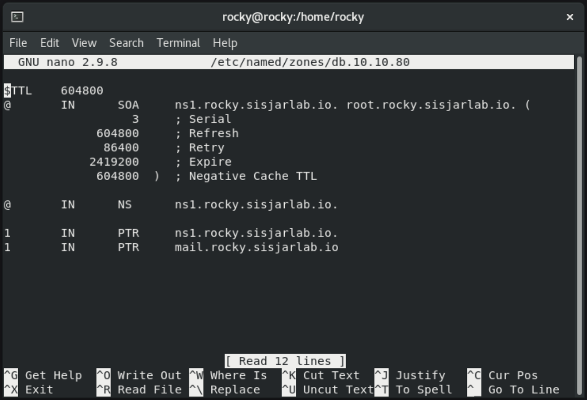

12. Lakukan restart named dengan command:

    ```bash
    [root@rocky zones]# systemctl restart named
    ```

13. Matikan firewalld agar bisa diakses oleh main OS:

    ```bash
    [root@rocky zones]# systemctl stop firewalld
    ```

14. Kemudian disable firewalld:

    ```bash
    [root@rocky zones]# systemctl disable firewalld
    ```

### 4.5 Konfigurasi Thunderbird

> **Catatan tambahan (tidak ada di modul asli):** Langkah di bawah memakai Thunderbird pada Main OS (Windows), tetapi modul tidak menjelaskan cara memasangnya. Jika belum terpasang, pasang terlebih dahulu:
>
> 1. Buka <https://www.thunderbird.net>, pilih bahasa dan Windows, lalu klik **Download**.
> 2. Jalankan file `Thunderbird Setup ... .exe` dan ikuti wizard (**Next** → **Install** → **Finish**).
> 3. Atau lewat terminal (jika `winget` tersedia): `winget install Mozilla.Thunderbird`
>
> Tampilan pada modul memakai Thunderbird versi 102; versi yang lebih baru bisa memiliki wizard akun yang sedikit berbeda (cari opsi **Configure manually** / **Manual config**). Pada Rocky Linux, Thunderbird sudah terpasang lewat perintah `dnf` di bagian 4.2.

1. Buka Command Prompt pada Main OS.
2. Selanjutnya ketikkan `nslookup mail.rocky.sisjarlab.io`.

   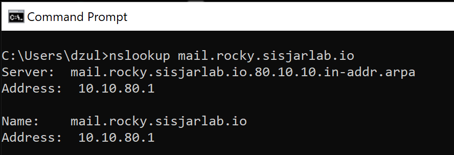

3. Buatlah 2 User pada Rocky Linux dengan format `namapendek01` dan `namapendek02`. Untuk password samakan dengan username. (Ganti `namapendek` ke nama pendek masing-masing.) **(SILAKAN SKIP STEP INI JIKA SUDAH DILAKUKAN DI TUGAS PENDAHULUAN)**

   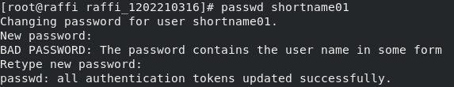

   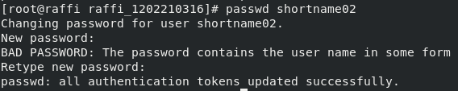

4. Buka Thunderbird pada Main OS lalu pilih Local Folders dan klik Email.

   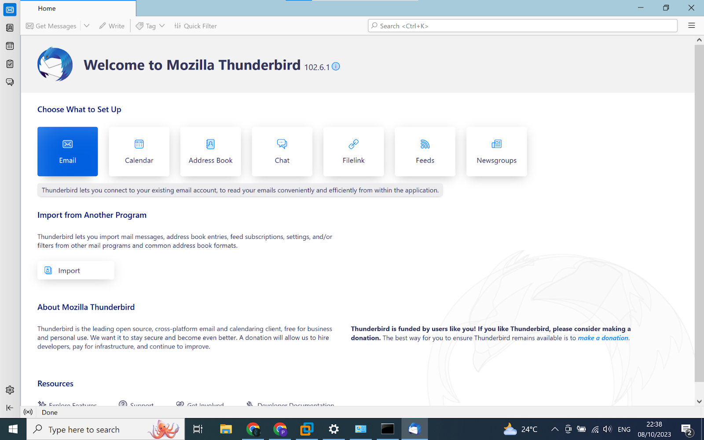

5. Masukkan full name, email address, dan password dengan catatan:

   - Full name = nama user 1 (`namapendek01`) yang telah kita buat
   - Email = nama user 1 (`namapendek01`) yang telah kita buat kemudian ditambahkan dengan `@mail.rocky.sisjarlab.io`
   - Password = berdasarkan password user 1 (`namapendek01`) yang telah kita buat di Rocky Linux

   Setelah itu kita klik **Continue**.

   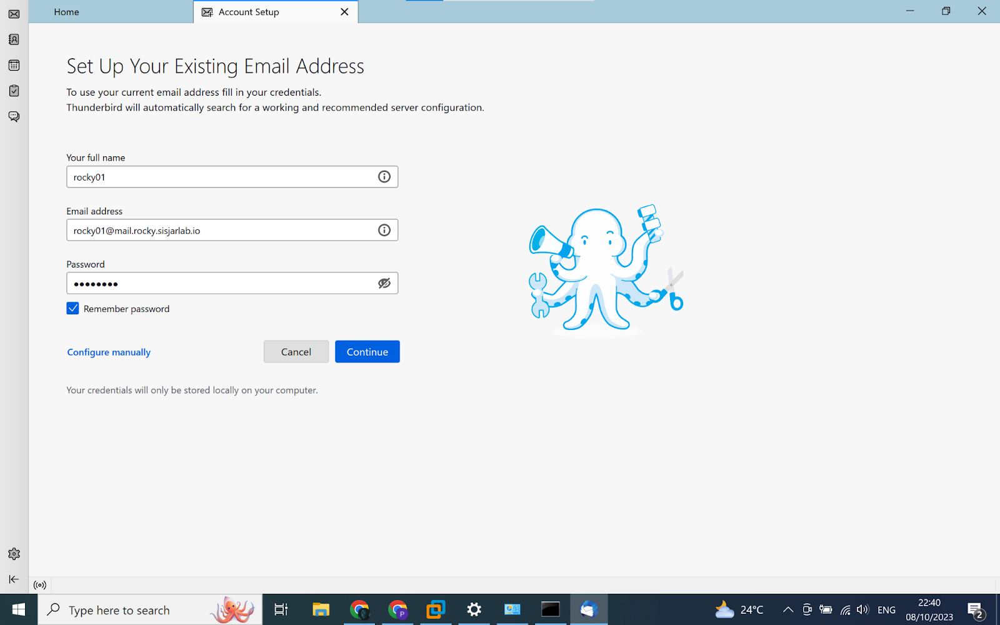

6. Kemudian kita klik **Configure manually**. Setting Outgoing Server pada bagian Authentication method menjadi **no authentication**. Setelah itu klik **Done**.

   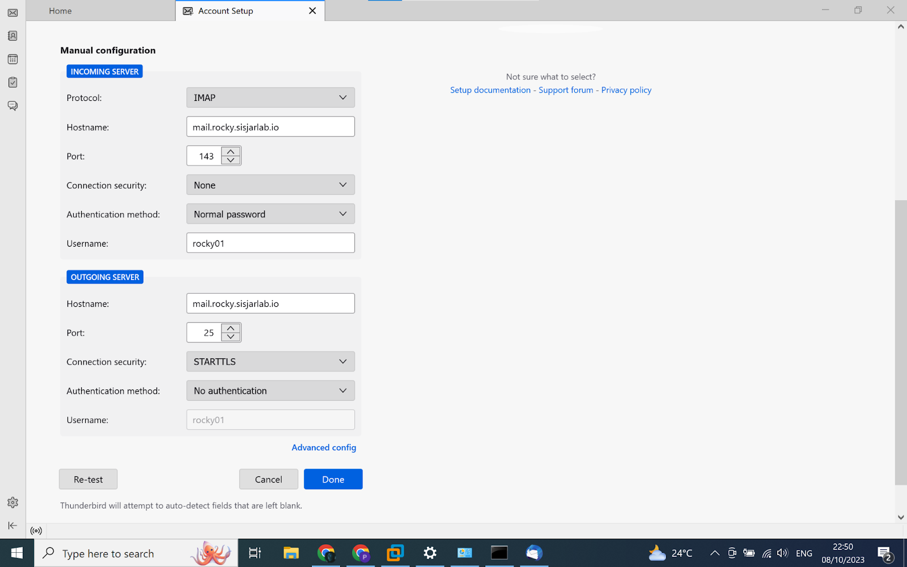

7. Checklist **I understand the risk**, kemudian klik **Confirm**.

   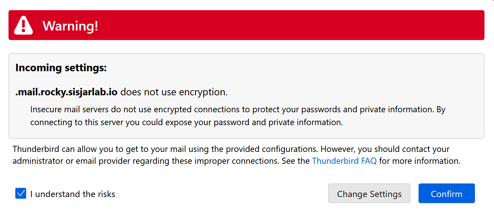

8. Klik **Finish**.
9. Lakukan hal yang sama pada Thunderbird di OS Rocky Linux untuk `namapendek02`.

   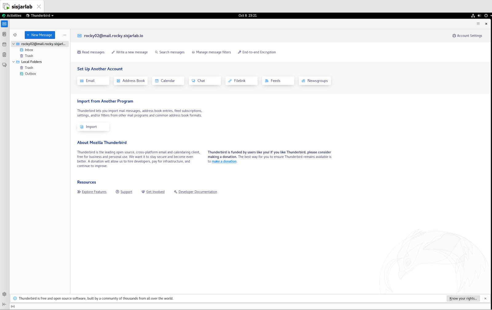

   *(Langkah 3 menggunakan user `shortname01` dan `shortname02` sebagai contoh dalam gambar.)*

10. Lakukan pengetesan klik **New message** dengan melakukan pengiriman dari Thunderbird Rocky Linux ke Thunderbird Main OS.

    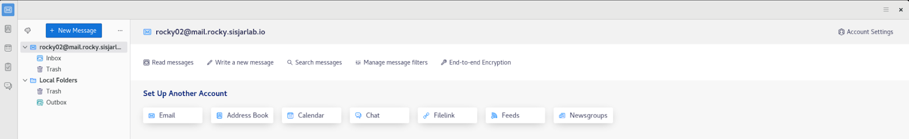

    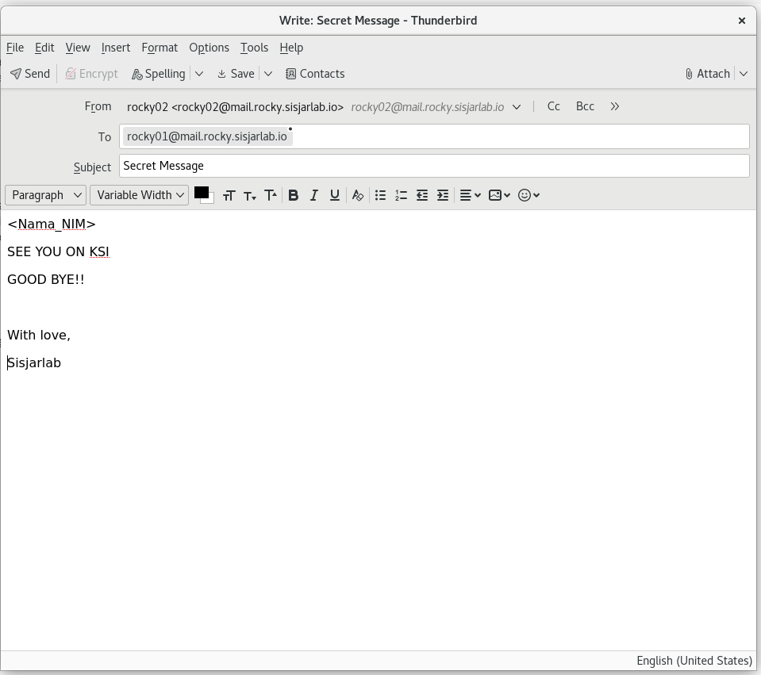

11. Setelah klik **Send** akan muncul notifikasi *Send Message Error*. Klik **OK**.
12. Klik **Confirm Security Exception**.

    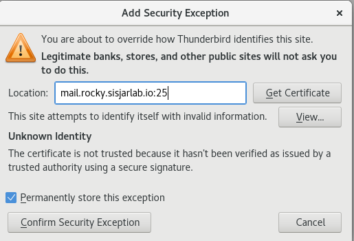

13. Kemudian klik **Send** kembali.
14. Cek inbox Thunderbird pada Main OS. Pesan telah diterima oleh akun pertama.

    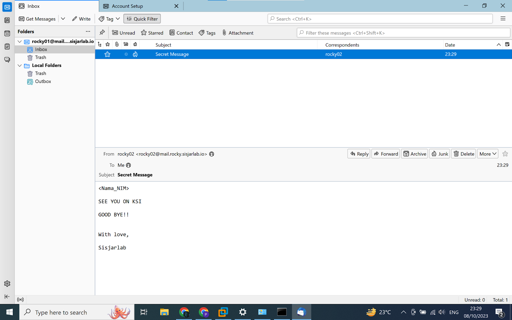

### 4.6 Konfigurasi Firewalld

Pada modul sebelumnya sudah melakukan konfigurasi web server dan DNS, selanjutnya pada bagian ini akan mencoba mengaktifkan firewall, kemudian menambahkan service HTTP dan DNS agar diizinkan oleh firewall untuk diakses.

1. Menyalakan firewalld dengan command:

   ```bash
   [root@rocky ~]# systemctl start firewalld
   ```

2. Lalu aktifkan firewalld dengan command:

   ```bash
   [root@rocky ~]# systemctl enable firewalld
   ```

3. Tambahkan service untuk DNS dan HTTP pada zone public:

   ```bash
   [root@rocky ~]# firewall-cmd --zone=public --add-service={dns,http} --permanent
   ```

   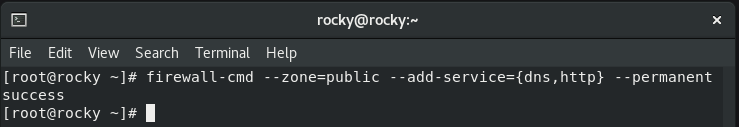

4. Selanjutnya restart firewalld dengan command:

   ```bash
   [root@rocky ~]# systemctl restart firewalld
   ```

5. Kemudian cek apakah service yang sebelumnya sudah ada atau belum:

   ```bash
   [root@rocky rocky]# firewall-cmd --list-service --zone=public
   ```

   

6. Jika sudah terdapat service selanjutnya beralih ke Main OS, ubah IP pada VMnet1 menjadi seperti berikut:

   

7. Buka Command Prompt pada Main OS kemudian masukkan command:

   ```bat
   ipconfig /flushdns
   ```

   

8. Selanjutnya buka browser pada main OS kemudian masukkan domain `rocky.sisjarlab.io` (`rocky` diganti nama masing-masing pada modul sebelumnya) pada address bar browser. Jika berhasil maka akan muncul tampilan seperti pada gambar berikut:

   

9. Untuk membuktikan apakah firewalld ini benar-benar berfungsi atau tidak, kita coba untuk memblokir service http kembali dengan command berikut:

   ```bash
   [root@rocky ~]# firewall-cmd --zone=public --remove-service=http --permanent
   ```

10. Selanjutnya restart firewalld:

    ```bash
    [root@rocky ~]# systemctl restart firewalld
    ```

11. Memastikan service yang diblokir sudah terhapus dengan command:

    ```bash
    [root@rocky rocky]# firewall-cmd --list-service --zone=public
    ```

    

12. Terakhir buka kembali browser pada main OS kemudian masukkan domain `rocky.sisjarlab.io` pada address bar browser. (Pastikan cache pada browser sudah dihapus.)

    

## 5. Daftar Pustaka

1. Laboratorium Sistem Operasi dan Jaringan Komputer. (2015). *Modul Praktikum Sistem Operasi 2015*. Bandung, Laboratorium Sistem Operasi dan Jaringan Komputer.
2. Laboratorium Sistem Operasi dan Jaringan Komputer. (2016). *Modul Praktikum Sistem Operasi 2016*. Bandung, Laboratorium Sistem Operasi dan Jaringan Komputer.
3. Laboratorium Sistem Operasi dan Jaringan Komputer. (2019). *Modul Praktikum Sistem Operasi 2019*. Bandung, Laboratorium Sistem Operasi dan Jaringan Komputer.
4. Laboratorium Sistem Operasi dan Jaringan Komputer. (2020). *Modul Praktikum Sistem Operasi 2020*. Bandung, Laboratorium Sistem Operasi dan Jaringan Komputer.
